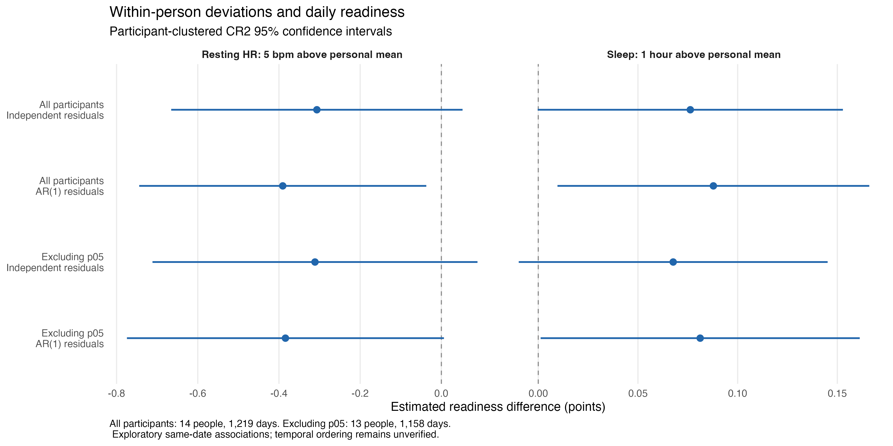
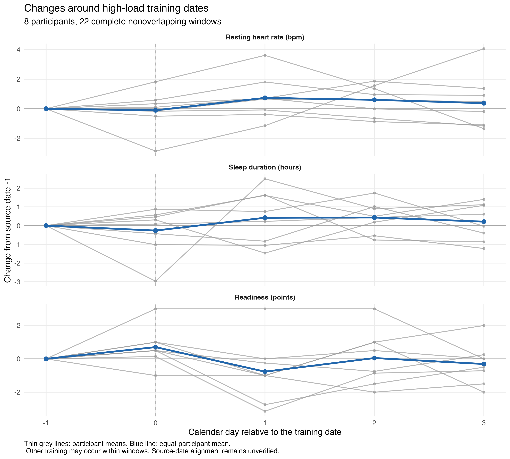
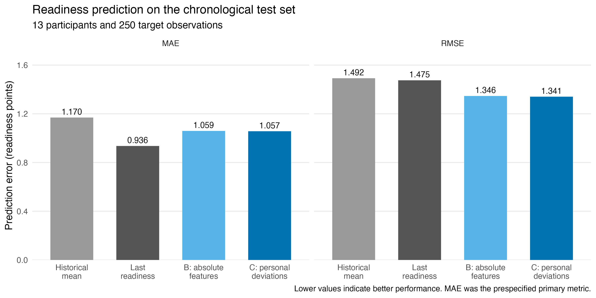

# Wearable Recovery and Daily Readiness：分析方法与结果总结

整理日期：2026-11-10。本文总结项目当前已经完成的分析，以 `R/` 中的实际实现和 `results/` 中保存的结果为依据；原始 proposal 中的候选方法不等同于最终使用的方法。文中的 readiness 指 **readiness to exercise，即自报运动准备程度，量表范围为 0–10 分**。

## 1. 项目回答了什么问题，最后发现了什么

项目使用 PMData 的纵向可穿戴设备和自报数据，围绕三个问题开展分析：

| 研究目标 | 实际采用的方法 | 主要发现 |
| --- | --- | --- |
| Aim 1：一个人的生理指标偏离平常水平时，readiness 是否随之变化？ | 区分个体内偏差与个体间均值的随机截距线性混合模型；比较独立残差和 AR(1) 残差结构；使用参与者聚类 CR2 稳健置信区间 | 静息心率高于个人均值与较低 readiness 相关，睡眠长于个人均值与略高 readiness 相关。各版本估计方向一致，但置信区间是否包含 0 随模型设定而变。 |
| Aim 2：个人高训练负荷日之后，生理指标和 readiness 如何变化？ | 以个人训练负荷第 75 百分位数定义事件，描述前一天至之后三天的轨迹，并检查事件重叠和参与者影响 | 主要样本中，次日静息心率约上升 0.73 bpm、readiness 约下降 0.77 分；随后心率差异缩小，readiness 有波动。数据支持描述短期变化，尚不能确定统一恢复时长。 |
| Aim 3：加入个人历史基线偏差，能否改善未来 readiness 的预测？ | 按时间划分训练、验证、测试集；比较两种问卷历史基线与两种 ridge regression 模型 | 个性化 ridge 相比绝对值 ridge 的测试集 MAE 仅降低约 0.0024 分；测试集 MAE 最低的是“最近一次 readiness”基线，个性化 ridge 的 RMSE 最低。 |

项目最直接的研究结论是：**个人生理偏差与日常主观 readiness 存在小幅关联，但这种关联没有在当前预测比较中转化成明显的额外预测收益。**

## 2. 数据来源、变量和最终样本

### 2.1 数据来源与研究设计

- 数据集：PMData: A Sports Logging Dataset；来源链接见[项目数据说明](data/README.md)。
- 设计：探索性、观察性、纵向重复测量分析。
- 当前日历面板覆盖：2019-11-01 至 2020-04-01；各参与者实际覆盖长度不同。
- 原始文件检查涉及 `p01`–`p16` 共 16 人。其中 `p12`、`p13` 缺少所需静息心率文件，最终导入 14 人。
- Aim 1 和 Aim 3 的基本单位是“参与者—日期”；Aim 2 的单位是高负荷训练日及其周围日期窗口。

### 2.2 实际使用的文件与变量

| 数据文件 | 提取或构造的变量 | 实际用途 |
| --- | --- | --- |
| `pmsys/wellness.csv` | 问卷时间、readiness、fatigue、自报睡眠时长 | readiness 是建模结局；fatigue 和自报睡眠时长用于数据检查或记录复核 |
| `fitbit/resting_heart_rate.json` | 每日静息心率，单位 bpm | Aim 1 生理关联、Aim 2 轨迹、Aim 3 历史特征 |
| `fitbit/sleep.json` | `minutesAsleep`、主睡眠标记、睡眠起止时间 | 用 `minutesAsleep / 60` 计算客观睡眠小时数，进入三个目标 |
| `pmsys/srpe.csv` | 训练结束时间、RPE、训练分钟数、活动名称 | Aim 2 训练负荷与事件选择 |

最终实现的结局模型均针对 readiness。最初计划中的 fatigue 次要结局模型、sleep score、步数/活动分钟、年龄效应分析没有进入当前完成的模型；训练负荷用于 Aim 2，没有加入 Aim 1 或 Aim 3。

### 2.3 最终数据规模

| 层次 | 数量 |
| --- | ---: |
| 导入参与者 | 14 人 |
| 日历面板 | 2,077 个参与者日 |
| 有 readiness 的日期 | 1,578 个参与者日 |
| 有有效静息心率的日期 | 1,658 个参与者日 |
| 有主睡眠时长的日期 | 1,822 个参与者日 |
| readiness、静息心率、睡眠同时完整的 Aim 1 样本 | 1,219 个参与者日，14 人 |
| Aim 1 排除 p05 的敏感性样本 | 1,158 个参与者日，13 人 |
| Aim 2 主要轨迹样本 | 22 个完整、无邻近高负荷候选事件的窗口，8 人 |
| Aim 3 可用预测样本 | 训练 968、验证 346、测试 250 个目标日期 |

来源：[文件检查](results/file_inventory.csv)、[数据覆盖](results/data_coverage.csv)、[Aim 1 样本](results/analysis_sample_counts.csv)、[Aim 2 样本](results/aim2_trajectory_sample_context.csv)、[预测特征覆盖](results/prediction_feature_coverage.csv)。

## 3. 数据怎样清理、对齐和检查

### 3.1 清理和每日记录选择

1. 保留原始时间文本，解析问卷和训练的 UTC 时间；按参与者处理各数据流。
2. 对提取后的静息心率和睡眠字段删除完全相同的记录。本次实际删除 61 条完全重复的睡眠记录。
3. 将 145 条非正静息心率记录设为缺失，不将其作为有效生理测量。
4. 同一 UTC 日期有多次 wellness 报告时，主要分析选择最早一次；记录每日原始报告数，并检查最早时间是否存在并列。
5. 睡眠仅选择 `mainSleep == TRUE` 的记录，使用 Fitbit 的 `dateOfSleep` 日期标签；不把当天其他睡眠片段累加为主睡眠。
6. 每位参与者建立连续的每日历，再按参与者和源日期标签合并问卷、心率和睡眠；缺测日也保留，因此后续 lag 表示实际日历天数。

最终 wellness 从 1,592 条报告选为 1,578 个日期，去除完全重复记录后的 1,938 条睡眠记录选为 1,822 条主睡眠记录。

### 3.2 数据质量检查及处理原则

- 检查 readiness 是否在 0–10、fatigue 是否在 1–5；本次没有发现越界值。
- 对少于 4 小时的睡眠做记录复核，保留原测量，没有统一按短睡眠阈值删除。
- readiness 等于 0 是合法量表值，主分析保留。p05 在全部 134 个 readiness 日期中有 57 个 0 值，且报告模式需要复核，因此另做排除 p05 的敏感性分析；其 Aim 1 完整样本包含 61 天，其中 7 天为 0。
- 检查过早填写问卷、睡眠结束时钟较晚、睡眠结束日期与 `dateOfSleep` 是否一致，以及各人的缺测和时间轨迹。
- Aim 1 使用完整案例，不填补缺失结局或生理测量；Aim 3 的预测变量缺失则按训练集规则处理，详见第 6 节。

### 3.3 日期对齐的实际含义

当前合并依据源文件的日期标签。问卷与训练时间解析为 UTC，但 **Fitbit 睡眠时间的时区及跨数据流的精确时间对应关系仍未核实**。睡眠结束日期标签与 `dateOfSleep` 一致，也不等于确认了其与问卷的先后顺序。

因此，Aim 1 应解释为同源日期标签下的关联；Aim 2 的 +1/+2/+3 指后续日历日期，不能直接当作训练结束后精确 24/48/72 小时。Aim 3 将可穿戴特征额外滞后至目标日前两天，以减少时间对齐不确定性造成的信息提前使用，但这并不能验证设备数据的实际可用时刻。

相关实现：[清理](R/02_clean.R)、[每日选择](R/02b_make_daily.R)、[日历合并](R/03_merge.R)、[数据质量](R/04a_quality_review.R)、[时间检查](R/04b_review_timing.R)、[零值复核](R/04c_review_readiness.R)。

## 4. Aim 1：个人生理偏差与日常 readiness 的关联

### 4.1 特征构造：区分个体内变化与个体间差异

先用每个人全观察期内所有有效记录分别计算静息心率均值与睡眠时长均值，再构造：

```text
hr_deviation    = 当天静息心率 − 该参与者全期平均静息心率
sleep_deviation = 当天睡眠小时数 − 该参与者全期平均睡眠小时数
```

这些均值利用各数据流所有有效日期，不只利用三个核心变量同时完整的日期。模型同时纳入个人均值和当日偏差，以区分“平常心率不同的人之间的差异”和“同一个人今天偏离平常水平的变化”。个人均值再减去参与者均值的平均值，以便解释截距。

**这里的全期均值只用于关联分析；Aim 3 重新构造仅依赖历史的基线，未将全期均值用作预测特征。**

### 4.2 实际使用的模型

初始模型使用 `lmerTest::lmer()` / `lme4`，通过 REML 拟合参与者随机截距线性混合模型：

```r
readiness ~ hr_deviation + sleep_deviation +
  hr_person_mean_c + sleep_person_mean_c +
  study_day_30 + (1 | participant_id)
```

其中 `study_day_30` 是距离全局研究起始日期的天数除以 30，用于调整线性时间趋势。模型让每个人有不同的基线 readiness，但生理偏差的斜率在参与者之间相同；没有拟合随机斜率。readiness 作为连续分数处理。

初始拟合使用 1,219 个参与者日，数值上收敛且非奇异。随后检查残差对拟合值、Q–Q 图、参与者残差离散程度，以及相邻真实日历日的残差相关。

为检查残差时间依赖，使用 `nlme::lme()`，保持固定效应公式一致，拟合四个版本：

| 版本名称 | 参与者/日期 | 残差结构 |
| --- | --- | --- |
| `iid_all` | 14 人，1,219 天 | 独立残差 |
| `ar1_all` | 14 人，1,219 天 | 参与者内 AR(1) |
| `iid_without_p05` | 13 人，1,158 天 | 独立残差 |
| `ar1_without_p05` | 13 人，1,158 天 | 参与者内 AR(1) |

AR(1) 使用实际日历日期间距，包括缺测间隔；每个模型估计一个参与者共用的相关参数。全样本估计 `rho = 0.291`，排除 p05 后为 `0.252`。

所有四个版本均进一步用 `clubSandwich` 计算**按参与者聚类的 CR2 稳健协方差**，通过 Satterthwaite 自由度构造 95% 置信区间。这样同时考察时间相关设定和以参与者为独立聚类单位的推断。CR2 只重新计算不确定性，不改变已拟合的系数。

### 4.3 主要结果

下表均使用参与者聚类 CR2 的 95% 置信区间。心率统一换算为“高于个人均值 5 bpm”，睡眠为“高于个人均值 1 小时”；结局单位均为 readiness 分数。

| 模型版本 | 心率 +5 bpm：估计值 [95% CI] | 睡眠 +1 小时：估计值 [95% CI] |
| --- | ---: | ---: |
| 独立残差，全样本 | −0.307 [−0.665, 0.052] | 0.076 [−0.0003, 0.153] |
| AR(1)，全样本 | −0.391 [−0.744, −0.037] | 0.088 [0.010, 0.166] |
| 独立残差，排除 p05 | −0.311 [−0.712, 0.089] | 0.068 [−0.010, 0.145] |
| AR(1)，排除 p05 | −0.384 [−0.774, 0.006] | 0.081 [0.001, 0.161] |

可以得出的发现：

- 四个版本的方向一致：个人心率偏高对应较低 readiness，睡眠偏长对应略高 readiness。
- 以全样本 AR(1) 版本为例，心率高于个人平常水平 5 bpm 与 readiness 低约 0.39 分相关；睡眠长 1 小时与 readiness 高约 0.09 分相关。
- 心率关联在排除 p05 后大小接近，但稳健区间略包含 0；睡眠关联在两个 AR(1) 版本中区间均高于 0，而独立残差版本的区间接近或跨过 0。应保留这种模型依赖性。
- 个人平均心率、平均睡眠以及线性时间趋势的 CR2 区间在四个版本中均包含 0，当前证据不足以明确这些项的关联。
- 初始模型的常规模型区间对心率和睡眠均不包含 0；在稳健推断下部分区间包含 0，说明只引用初始模型会高估结论的确定性。

### 4.4 同一天问卷选择的敏感性分析

在固定原分析日期、预测变量和模型设定的情况下，将每日最早 readiness 换为最晚 readiness。1,219 个完整日期中有 8 天存在多次问卷，只有 3 天的 readiness 实际改变。

全样本 AR(1) 的每 1 bpm 心率系数由 `−0.0781` 变为 `−0.0803`，睡眠系数由 `0.0878` 变为 `0.0885`，结果变化很小。每日取最早还是最晚一次报告不是此次主要关联的主要来源。



主要依据：[特征构造](R/05_build_features.R)、[初始模型](R/07_fit_aim1.R)、[残差诊断](R/08_check_aim1.R)、[时间相关和排除分析](R/09_check_robustness.R)、[CR2 推断](R/10_robust_intervals.R)、[展示单位结果表](results/aim1_robust_estimates_display_units.csv)、[全部系数与区间](results/aim1_interval_comparison_all_terms.csv)、[问卷选择比较](results/aim1_report_choice_comparison.csv)。

## 5. Aim 2：个人高训练负荷日周围的短期变化

### 5.1 训练负荷怎样定义

```text
单次训练负荷 = 自报 RPE × 训练时长（分钟）
当日训练负荷 = 同一参与者、同一 UTC 训练结束日期内各次训练负荷之和
```

检查训练时间、RPE 和时长；RPE 有效范围为 0–10，时长须为正数。任一次已报告训练的信息不完整时，该日期总负荷设为未知。没有训练报告的日期也视为负荷未知，不当作负荷为 0 的休息日。

当前 14 人共有 733 条训练记录，722 条可计算负荷；11 条不可计算记录均来自 p16，缺少 RPE 和时长。681 个有训练记录的日期中，670 天有可计算的总负荷。

### 5.2 高负荷事件和窗口选择

1. 参与者至少有 20 个可计算负荷的训练日期才有资格定义事件，共 10 人符合条件。
2. 使用各人有负荷记录日期的第 75 百分位数为阈值，日负荷大于或等于阈值即为候选事件，共 192 个。阈值来自个人已记录的训练日分布，而非所有日历日。
3. 对每个事件取 `−1、0、+1、+2、+3` 五个源日期，检查 readiness、心率和睡眠是否全部存在。
4. 为减少高负荷事件相互混叠，主要分析要求事件前后四个日历日内没有其他高负荷候选事件。192 个候选中有 50 个满足间隔条件，再要求五天三个指标全部完整，留下 **8 人、22 个事件**。
5. 比较样本包含所有五天完整的候选事件，共 **10 人、73 个事件**，允许相邻高负荷事件。

“无邻近高负荷候选事件”不代表后续没有其他训练。主要样本 22 个窗口中，有 10 个在 +1 至 +3 日仍有训练记录；全部完整样本中为 54/73。

### 5.3 轨迹怎样计算

这里采用事件对齐的描述性分析，没有拟合恢复时间模型或训练效应回归模型。

```text
每项指标的变化 = 该相对日期的测量 − 同一事件前一天（−1 日）的测量
```

先在每个人内部对其事件变化求平均，再对参与者均值求平均，让每个人在总轨迹中权重相同。**参考点是该事件的前一天，而非 Aim 1 的全期个人均值。**

### 5.4 主要轨迹结果

主要样本为 8 人、22 个完整且无邻近高负荷候选事件的窗口。睡眠变化从小时换算为分钟。

| 相对训练日期 | 静息心率变化（bpm） | 睡眠变化（分钟） | readiness 变化（分） |
| --- | ---: | ---: | ---: |
| −1 | 0 | 0 | 0 |
| 0 | −0.10 | −15.9 | 0.71 |
| +1 | 0.73 | 25.3 | −0.77 |
| +2 | 0.60 | 26.0 | 0.05 |
| +3 | 0.38 | 12.7 | −0.31 |

主要发现是：相对于事件前一天，次日心率更高、readiness 更低，后续心率差异逐步缩小，睡眠在 +1/+2 日较长。readiness 在 +2 日接近前一天水平，但 +3 日再次偏低，没有呈现统一、单调的恢复曲线。第 0 日的问卷或睡眠也未必发生在当天训练之后，不能解释为即时训练反应。

允许重叠事件的 10 人、73 事件样本中，+1 日平均心率变化为 `+0.58 bpm`、readiness 为 `−0.45 分`；+3 日分别为 `+0.16 bpm`、`−0.16 分`。两种样本的总体方向相近，但参与者和事件构成不同，不能把它们的差别仅归因于窗口重叠。

### 5.5 逐一排除参与者的检查

每次排除一人及其所有事件，在其余 7 人中重新计算等权轨迹。主要样本 +1 日的结果范围为：

- 心率：`+0.32` 至 `+1.00 bpm`。
- readiness：`−1.31` 至 `−0.43 分`。
- 睡眠：`+7.4` 至 `+41.4 分钟`。

次日变化的方向在这些排除版本中一致，但幅度受个别参与者影响。+2 日 readiness 和 +3 日心率的排除范围跨过 0。图中的范围表示参与者组成敏感性，**不是置信区间**。

当前分析描述了高负荷日前后的短期模式，没有确立因果训练效应、精确恢复时长或经过验证的生理韧性指标。



主要依据：[训练清理](R/14_prepare_training_sessions.R)、[每日负荷与覆盖](R/15_training_daily_coverage.R)、[事件规则](R/16_select_training_events.R)、[轨迹计算](R/17_plot_training_trajectories.R)、[逐人排除检查](R/18_check_trajectory_sensitivity.R)、[事件数量](results/aim2_event_counts.csv)、[轨迹数值](results/aim2_trajectory_summary.csv)、[敏感性结果](results/aim2_participant_sensitivity.csv)。

## 6. Aim 3：未来 readiness 的预测比较

### 6.1 预测任务和时间划分

任务是利用已观察过的参与者的历史数据，滚动预测目标日 `d` 的 readiness：问卷历史截至 `d−1`；可穿戴指标使用 `d−2` 的源日期值。若前一天没填问卷，“最近一次 readiness”可来自更早日期，另用距离该报告的天数记录间隔。

按全局日历范围预先固定约 60%/20%/20% 的时间边界，之后再筛选有实际结局的日期，没有随机打乱或按人留出：

| 数据分区 | 日历范围 | 有观测 readiness 的日期 | 有历史 readiness、最终用于比较的日期 | 参与者 |
| --- | --- | ---: | ---: | ---: |
| 训练 | 2019-11-01 至 2020-01-30 | 982 | 968 | 14 |
| 验证 | 2020-01-31 至 2020-03-01 | 346 | 346 | 14 |
| 测试 | 2020-03-02 至 2020-04-01 | 250 | 250 | 13 |

实际测试目标出现在 2020-03-02 至 2020-03-30；预设测试边界到 04-01。训练期最初没有历史 readiness 的 14 个目标日期被排除。所有模型在同一分区内使用同一批目标日期。

验证和测试期间，较早日期已经观察到的问卷或设备记录可以更新较晚日期的历史特征；模型系数和预处理参数保持固定。因此，这是对已知参与者的逐日滚动预测，不是一次性预测整个未来月份，也没有评估陌生参与者。

### 6.2 实际比较的四个模型

| 名称 | 预测规则或特征 | 方法 |
| --- | --- | --- |
| `baseline_last_readiness` | 直接沿用该目标日期之前最近一次 readiness | 历史持续性基线，无需拟合 |
| `baseline_past_mean` | 该目标日期之前所有已观察 readiness 的累积均值 | 历史均值基线，无需拟合 |
| `B_absolute` | 参与者、星期几、最近 readiness、历史 readiness 均值、距最近报告天数、`d−2` 心率、`d−2` 睡眠 | Ridge regression（L2 正则化线性回归） |
| `C_personal` | B 的全部特征，再加 `d−2` 心率和睡眠相对各自历史滚动均值的偏差 | Ridge regression（L2 正则化线性回归） |

两种 ridge 均已包含个人身份和 readiness 历史。因此，C 对 B 的比较是在已有这些信息的基础上，检验两个个人生理偏差特征及其缺失指示是否提供额外信息。

### 6.3 个人历史基线与防止信息泄漏

- 对 `d−2` 的可穿戴值，基线使用其之前 14 个日历日期，即目标日期 `d−16` 至 `d−3` 的有效记录。
- 心率和睡眠分别要求至少 5 个有效观测，否则相应基线和偏差记为缺失。
- `hr_deviation_lag2 = hr_lag2 − hr_baseline_lag2`；睡眠同理。
- 历史 readiness 均值只累计目标日之前已观测的值，不包含目标日结局。
- 不使用 Aim 1 的全观察期个人均值，不使用目标日或未来的生理数据。

测试集 250 个目标中，225 个有两项绝对可穿戴值，216 个有两项个人偏差；其余仍保留，通过既定缺失处理规则进行预测。

### 6.4 预处理和 ridge 拟合

所有预处理参数仅由原训练集估计：

1. 数值特征缺失用训练集中位数填补，并为每个数值特征增加缺失指示列。
2. 参与者和星期几做完整 one-hot 编码，类别来自训练集。
3. 所有设计矩阵列按训练均值和标准差中心化、标准化；训练标准差为 0 的列缩放因子设为 1。
4. B 的矩阵有 31 列，C 有 35 列；输入处理后没有非有限值。结局不填补、不标准化。

Ridge 使用 base R 矩阵运算和 `solve()` 实现，目标函数为：

```text
最小化：mean((y − intercept − Xβ)^2) + λ × sum(β²)
截距不受惩罚。
```

惩罚参数网格为 `10^seq(-4, 2, by = 0.5)`，共 13 个值；以验证集 pooled MAE 选择，完全并列时选更大的 λ。B 和 C 都选中 `λ = 1`，均不在网格边界。

验证集还用于从两种简单基线中选定正式参考：历史均值基线 MAE 更低，因此正式参考为 `baseline_past_mean`。测试阶段直接使用原训练期拟合的系数和预处理参数，**没有合并训练集和验证集重新拟合**。所有预测截断在 0–10。

### 6.5 评价指标

- **Pooled MAE**：所有目标日期的平均绝对误差，主要选择指标；观察日期较多的人权重更大。
- **Pooled RMSE**：所有目标日期均方误差的平方根，对较大误差更敏感。
- **Macro MAE**：先算每个人的 MAE，再对参与者等权平均。
- 同时保存每位参与者的 MAE/RMSE 和逐日期预测。

### 6.6 验证集结果

验证集为 346 个目标日期、14 人。

| 模型 | MAE | RMSE | Macro MAE |
| --- | ---: | ---: | ---: |
| 最近一次 readiness | 1.1012 | 1.5664 | 1.0418 |
| 历史 readiness 均值 | 1.0842 | 1.4373 | 1.0466 |
| B：绝对值 ridge | 0.9897 | 1.2819 | 0.9505 |
| C：加入个人偏差的 ridge | 0.9861 | 1.2766 | 0.9469 |

验证集上两种 ridge 均优于正式参考基线；C 比 B 略好。

### 6.7 最终测试集结果

测试集为相同的 250 个目标日期、13 人。所有误差单位均为 readiness 分数。

| 模型 | MAE | RMSE | Macro MAE | 相对正式参考基线的 MAE 降幅 |
| --- | ---: | ---: | ---: | ---: |
| 最近一次 readiness | **0.9360** | 1.4751 | **0.8251** | 19.97% |
| 历史 readiness 均值（验证集选定的参考） | 1.1695 | 1.4922 | 1.0683 | 0% |
| B：绝对值 ridge | 1.0594 | 1.3464 | 0.9901 | 9.42% |
| C：加入个人偏差的 ridge | 1.0570 | **1.3408** | 0.9898 | 9.62% |

结果的含义：

1. **C 相对 B 的额外收益很小。** 测试 MAE 由 1.0594 降至 1.0570，绝对下降约 0.0024 分、相对下降约 0.23%；13 人中有 6 人的 MAE 改善。当前比较没有显示个人偏差特征带来明显增益。
2. **C 优于验证集选定的历史均值参考，但没有在主要指标上超过所有简单基线。** 最近一次 readiness 的测试 MAE 为 0.9360，低于 C 的 1.0570；macro MAE 也更低。
3. **不同误差指标给出不同排序。** C 的 RMSE 为 1.3408，低于最近一次 readiness 的 1.4751，表明在平方误差指标下 ridge 更有优势。不能仅据某一个指标宣称一个模型全面更优。
4. **验证期与测试期的基线排序改变。** 验证期历史均值 MAE 略优，测试期最近一次 readiness MAE 更低；时间段差异需要保留在结果解释中。

这些是当前单次时间留出上的描述性比较，没有为模型误差差异计算置信区间或统计检验。B/C 与简单基线之间同时改变了多个输入，不能把相对基线的全部改善单独归因于可穿戴指标；直接检验个人生理偏差增量的是 C 与 B 的比较。



主要依据：[时间划分审计](R/19_audit_prediction_data.R)、[历史特征](R/20_make_prediction_features.R)、[基线选择](R/21_compare_prediction_baselines.R)、[训练期预处理](R/22_prepare_prediction_matrices.R)、[ridge 拟合与调参](R/23_fit_prediction_models.R)、[固定模型测试](R/24_evaluate_prediction_test.R)、[验证结果](results/aim3_validation_model_comparison.csv)、[测试结果](results/aim3_test_model_comparison.csv)、[逐人误差](results/aim3_test_participant_metrics.csv)。

## 7. 最终用了哪些 model 和软件

| 分析部分 | 实际使用的模型/方法 | 实现 |
| --- | --- | --- |
| Aim 1 初始关联 | 随机截距线性混合模型，REML | R：`lmerTest`、`lme4` |
| Aim 1 时间相关比较 | 随机截距线性混合模型，独立或 AR(1) 残差，REML | R：`nlme` |
| Aim 1 稳健推断 | 参与者聚类 CR2、Satterthwaite 自由度 | R：`clubSandwich` |
| Aim 1 敏感性 | 排除 p05、最早与最晚问卷选择 | R：同上 |
| Aim 2 | 个人分位数事件选择、以前一天为参考的等参与者权重轨迹、逐人排除 | R：`dplyr`、`tidyr`、`ggplot2` |
| Aim 3 简单基线 | 最近 readiness、累积历史均值 | R：历史数据规则 |
| Aim 3 预测模型 | 两套特征的 ridge regression，验证集选择 λ | R：base R 矩阵运算 |
| 导入、清理、表格和图形 | JSON/CSV 导入、日历对齐、缺失审计、特征构造、可视化 | R：`jsonlite`、`readr`、`dplyr`、`tidyr`、`tibble`、`ggplot2` |

**最终三个研究目标全部用 R 完成。** 原计划的 Python/scikit-learn 扩展没有成为最终实现；没有使用随机森林或深度学习。Aim 2 完成的是描述性事件轨迹分析。

已保存的 Aim 1 环境记录为 R 4.2.1，主要版本包括 `lme4 1.1-32`、`lmerTest 3.1-3`、`nlme 3.1-157`、`clubSandwich 0.5.11`、`dplyr 1.1.4`、`readr 2.1.5`、`tidyr 1.3.1`、`ggplot2 3.5.1`。这描述的是已保存的运行环境，详见 [session info](results/10_session_info.txt)。

## 8. 如何复现，结果在哪里

在项目根目录、准备好 `data/README.md` 要求的原始文件和依赖后运行：

```r
source("R/00_run_project.R")
```

也可按顺序分别运行：

```r
source("R/00_run_aim1.R")
source("R/00_run_aim2.R")
source("R/00_run_aims3.R")
```

第三个入口的实际文件名为 `00_run_aims3.R`。Aim 2 和 Aim 3 依赖 Aim 1 的日历面板等产物。Aim 2 在缺少训练文件时会从 OSF 下载，因此该情况下需要联网。

目前保存的流水线日志显示：Aim 1 的 18 个阶段、Aim 2 的 6 个阶段、Aim 3 的 7 个阶段均为 `Completed`。本总结依据已有代码和输出整理，没有为撰写文档重新拟合模型。

| 内容 | 主要位置 |
| --- | --- |
| 项目概览与安装说明 | [README](README.md) |
| 原始数据获取方式 | [data/README.md](data/README.md) |
| 数据覆盖和清理审计 | [data_coverage.csv](results/data_coverage.csv)、[cleaning_audit.csv](results/cleaning_audit.csv) |
| Aim 1 稳健估计和区间 | [aim1_robust_estimates_display_units.csv](results/aim1_robust_estimates_display_units.csv)、[aim1_interval_comparison_primary.csv](results/aim1_interval_comparison_primary.csv) |
| Aim 2 样本与轨迹 | [aim2_trajectory_sample_context.csv](results/aim2_trajectory_sample_context.csv)、[aim2_trajectory_summary.csv](results/aim2_trajectory_summary.csv) |
| Aim 3 特征与分区定义 | [prediction_feature_specification.csv](results/prediction_feature_specification.csv)、[prediction_split_boundaries.csv](results/prediction_split_boundaries.csv) |
| Aim 3 最终测试结果 | [aim3_test_model_comparison.csv](results/aim3_test_model_comparison.csv)、[aim3_test_sample_context.csv](results/aim3_test_sample_context.csv) |
| 关键图形 | `figures/11_aim1_robust_estimates.png`、`figures/17_aim2_primary_trajectories.png`、`figures/25_aim3_test_error_comparison.png` |
| 流水线状态 | [Aim 1](results/aim1_pipeline_log.csv)、[Aim 2](results/aim2_pipeline_log.csv)、[Aim 3](results/aim3_pipeline_log.csv) |

原始数据、记录级中间文件、处理后数据和序列化模型保留在本地，按现有 `.gitignore` 排除。分享结果时应同时保留原数据集署名及数据获取说明。

## 9. 结论的适用范围

此次完成的证据来自一个小规模自然观察队列。关联分析包含 14 人；较严格的训练事件轨迹仅有 8 人、22 个窗口；预测测试包含 13 名已观察参与者。多天记录提高了对这些人日常变化的观察密度，但不能替代更多独立参与者。

主要解释边界包括：跨设备时区和精确事件顺序未核实；自报训练和缺测可能与人的状态有关；部分事件后仍有训练；readiness 是主观运动准备程度。当前模型没有建立睡眠、心率或训练的因果效应，也没有验证临床应用、年龄差异或生物年龄。

已经完成的工作把个人基线关联、训练事件周围变化和时间留出预测连成了一个可复核的分析流程。当前结果支持继续研究个体内生理变化与主观状态的关系；若进一步检验预测价值，关键是增加参与者、核实时间对齐，并在更多独立时间段和新参与者中验证。
