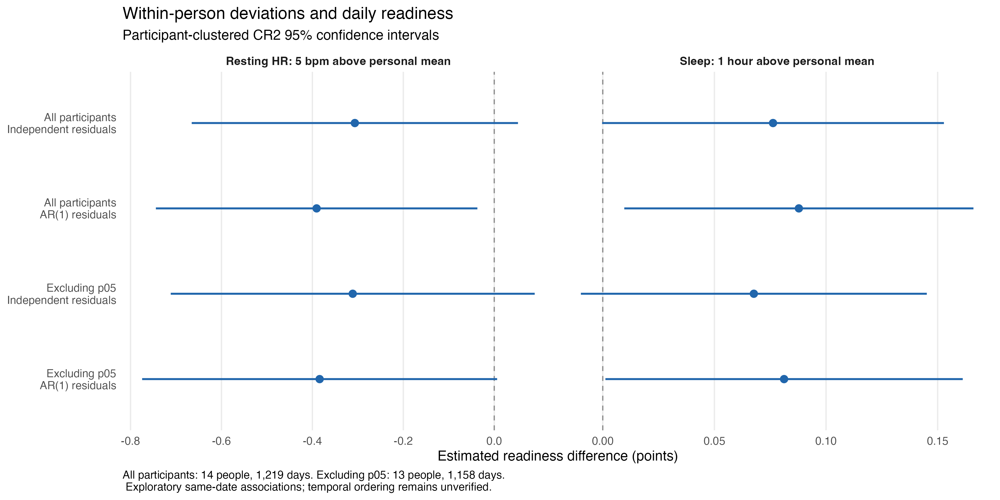

# Wearable Recovery and Daily Readiness

This project studies how changes in a person's resting heart rate and sleep relate to their readiness to exercise. Using [PMData](https://datasets.simula.no/pmdata/), it separates physiological variation within a person from differences between people, describes changes around higher training loads, and evaluates prediction on later dates.

All three analyses are implemented in R. Personal physiological deviations were associated with daily readiness, while recent readiness itself was a strong forecasting benchmark.

## Research aims and findings

| Aim | Analysis | Main finding |
| --- | --- | --- |
| 1. Personal baselines and readiness | Random-intercept mixed models separating personal means from daily deviations, with independent or AR(1) residuals and participant-clustered CR2 intervals. | Across 1,219 participant-days from 14 people, higher-than-usual heart rate was associated with lower readiness, and longer-than-usual sleep with higher readiness. |
| 2. Changes around higher training loads | Event trajectories relative to the preceding date, averaged within participants before giving each participant equal weight. | In 22 complete event windows from eight people, next-date heart rate was 0.73 bpm higher and readiness 0.77 points lower than on the preceding date. Selected events had no other high-load candidate within four calendar days. |
| 3. Future readiness prediction | Chronological training, validation, and test periods; two readiness-history baselines and ridge models using absolute or personalized physiological features. | On 250 test targets from 13 known participants, last readiness had the lowest MAE, while the ridge model with personal deviations had the lowest RMSE. |

In the full-sample AR(1) model, heart rate 5 bpm above personal mean corresponded to a readiness difference of -0.391 points (95% CI -0.744 to -0.037). An additional hour above personal mean sleep corresponded to +0.088 points (95% CI 0.010 to 0.166). Association directions were consistent across the four model versions; confidence intervals varied with residual structure and participant inclusion.



The prediction comparison used the same test targets for all four methods. MAE was the primary metric; RMSE gives more weight to larger errors. Both are in readiness points.

| Prediction method | Test MAE | Test RMSE |
| --- | ---: | ---: |
| Last observed readiness | 0.9360 | 1.4751 |
| Historical readiness mean | 1.1695 | 1.4922 |
| Ridge B, absolute features | 1.0594 | 1.3464 |
| Ridge C, added personal deviations | 1.0570 | 1.3408 |

Adding personal deviations to Model B reduced test MAE by 0.0024 points. Both ridge models already included participant, weekday, and readiness history. The historical-mean baseline was selected as the reference using validation MAE; the table retains both simple baselines for the test comparison.

See the [report](docs/report.md) for methods, event trajectories, and interpretation. Numerical sources: [association estimates](results/aim1_robust_estimates_display_units.csv), [event trajectories](results/aim2_trajectory_summary.csv), and [test predictions comparison](results/aim3_test_model_comparison.csv).

## Project documents

- [Research proposal](docs/research_proposal.md): research questions, data, and methods for all three aims.
- [Codebook](docs/codebook.md): variable definitions, units, historical windows, model coding, and result fields.
- [Report](docs/report.md): findings from the association, training-event, and prediction analyses.

## Data

The analysis combines PMSys wellness and session-RPE records with Fitbit daily resting heart rate and main-sleep duration. Readiness is self-reported readiness to exercise on a 0 to 10 scale. The imported daily panel contains 2,077 participant-days from 14 participants; individual analyses use the samples shown above.

Records are joined by source date labels. The Fitbit sleep time zone remains unverified; event offsets describe calendar dates. The reported associations describe this observational cohort. Prediction uses questionnaire history before each target date and wearable values from two source dates earlier. Personal predictive baselines use the 14 calendar dates before the wearable source date, with at least five valid observations.

Download the source files and follow the layout in [data/README.md](data/README.md). Raw participant files and generated analysis datasets remain local and are excluded from Git by `.gitignore`.

## Run the analysis

Download or clone the repository, obtain the source data, and open `wearable-readiness.Rproj` in RStudio. Run the following from the project root to install dependencies once:

```r
install.packages(c(
  "dplyr", "readr", "jsonlite", "tidyr", "tibble", "ggplot2",
  "lme4", "lmerTest", "nlme", "clubSandwich"
))
```

Run all three aims in order:

```r
source("R/00_run_project.R")
```

Alternatively, run the aim entry points individually, starting with Aim 1:

```r
source("R/00_run_aim1.R")
source("R/00_run_aim2.R")
source("R/00_run_aims3.R")
```

Aim 2 and Aim 3 read datasets generated by Aim 1. Aim 2 downloads missing training-session files from OSF and needs an internet connection when those files are absent. The pipelines write tables to `results/`, figures to `figures/`, and local analysis datasets beneath `data/`.

The saved Aim 1 environment used R 4.2.1. Package versions are recorded in [session information](results/10_session_info.txt).

## Project structure

```text
wearable-readiness/
├── README.md
├── wearable-readiness.Rproj
├── R/                         # Analysis scripts and pipeline entry points
├── docs/
│   ├── research_proposal.md
│   ├── codebook.md
│   └── report.md
├── data/
│   ├── README.md              # Data access and local file layout
│   ├── download_manifest.csv
│   └── training_download_manifest.csv
├── figures/                   # Analysis figures and diagnostics
└── results/                   # Tables, model comparisons, and pipeline logs
```

## Data source and attribution

The source dataset is PMData by Thambawita and colleagues. Obtain the original data through the [Simula dataset page](https://datasets.simula.no/pmdata/) or the [OSF repository](https://osf.io/vx4bk/), and follow the dataset's published use and attribution terms.

Thambawita et al. (2020). *PMData: A Sports Logging Dataset*. Proceedings of MMSys 2020. [Publication](https://doi.org/10.1145/3339825.3394926).
