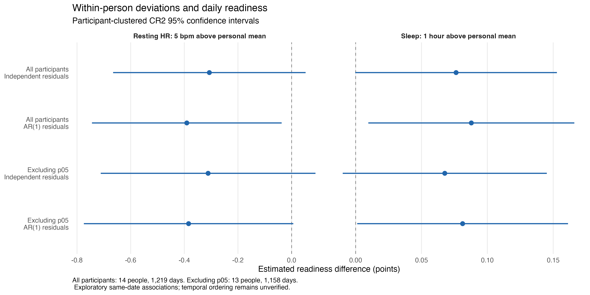
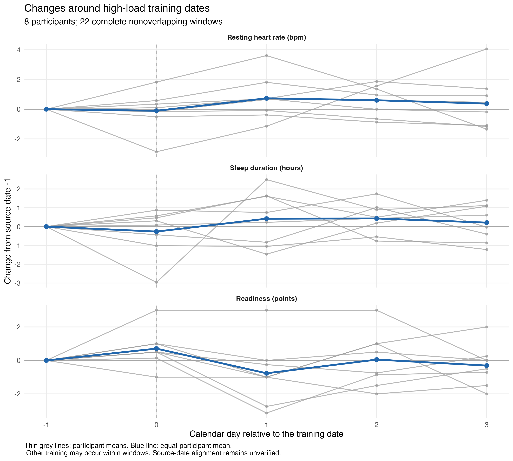
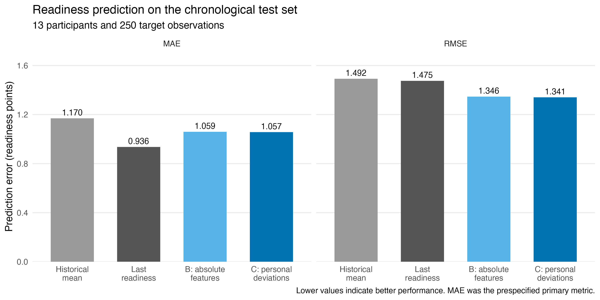

# Report on personal physiological deviations and daily exercise readiness

## Main findings

Daily exercise readiness varied with departures from each participant's usual physiology. In the model accounting for serial correlation, a resting heart rate 5 bpm above personal mean was associated with a 0.39-point lower readiness score, while an additional hour of sleep above personal mean was associated with a 0.09-point higher score. Higher training-load events were followed by higher next-date heart rate and lower readiness. In chronological prediction, the most recent readiness score gave the lowest mean absolute error, while the ridge model with personal deviations gave the lowest root mean squared error.

## Data and analysis

The study used [PMData](https://datasets.simula.no/pmdata/), combining PMSys wellness and training records with Fitbit resting heart rate and main-sleep duration. Fourteen participants had the required daily data streams; `p12` and `p13` lacked the required heart-rate file. The resulting calendar panel contained 2,077 participant-days, with 1,578 readiness observations and 1,219 dates with complete readiness, heart rate, and sleep measurements.

Readiness to exercise was scored from 0 to 10. The earliest wellness report on each UTC date defined the daily outcome, and zero scores were retained. Sleep duration was calculated from Fitbit main-sleep minutes. Exact duplicate wearable records were removed, and nonpositive heart rates were set to missing. The analyses used source date labels, with the Fitbit sleep time zone unresolved. [Data coverage](../results/data_coverage.csv), [cleaning audit](../results/cleaning_audit.csv).

## Aim 1 Associations within a person

The association model separated each person's daily physiological deviations from their full-period mean levels. It included a participant random intercept, both physiological means, and a linear time trend. Independent-residual and AR(1) versions were fitted by restricted maximum likelihood. All intervals below use participant-clustered CR2 inference with Satterthwaite degrees of freedom.

| Model | Readiness difference per 5 bpm above personal mean, 95% CI | Readiness difference per hour above personal mean sleep, 95% CI |
| --- | --- | --- |
| Independent residuals, all participants | -0.307 [-0.665, 0.052] | 0.076 [-0.0003, 0.153] |
| AR(1), all participants | -0.391 [-0.744, -0.037] | 0.088 [0.010, 0.166] |
| Independent residuals, excluding p05 | -0.311 [-0.712, 0.089] | 0.068 [-0.010, 0.145] |
| AR(1), excluding p05 | -0.384 [-0.774, 0.006] | 0.081 [0.001, 0.161] |

The direction and approximate size of both associations were consistent across model versions. Confidence intervals varied with the residual structure and participant sample. Excluding `p05`, whose readiness reporting pattern prompted review, left the heart-rate estimate close to the full-sample estimate. Using the latest daily readiness report changed the outcome on three analysis dates and produced similar associations. [Association estimates](../results/aim1_robust_estimates_display_units.csv), [report-selection sensitivity](../results/aim1_report_choice_comparison.csv).

## Aim 2 Changes around higher training loads

Daily training load was the sum of reported session RPE multiplied by duration in minutes. Participants needed at least 20 calculable training dates; an event was a day at or above their personal 75th percentile. The primary sample contained 22 events from eight participants, with complete measurements on source dates -1 through +3 and no other high-load candidate within four days.

Changes were measured from each event's preceding date. Events were averaged within participants before calculating an equal-participant mean. This analysis described trajectories without fitting a training-effect or recovery-time model.

| Date relative to training | Heart-rate change, bpm | Sleep change, minutes | Readiness change, points |
| --- | ---: | ---: | ---: |
| 0 | -0.10 | -15.9 | 0.71 |
| +1 | 0.73 | 25.3 | -0.77 |
| +2 | 0.60 | 26.0 | 0.05 |
| +3 | 0.38 | 12.7 | -0.31 |

Heart rate was higher on the next source date and moved closer to the reference over the following dates. Readiness was lower at +1, near the reference at +2, and lower again at +3. The +1 directions persisted when each participant was omitted in turn: heart-rate changes ranged from +0.32 to +1.00 bpm and readiness changes from -1.31 to -0.43 points. These ranges describe participant sensitivity, not confidence intervals.

Ten of the 22 windows included later training reports. The trajectories therefore describe the observed pattern around selected high-load days, with subsequent activity retained in the window. [Trajectory estimates](../results/aim2_trajectory_summary.csv), [sample context](../results/aim2_trajectory_sample_context.csv), [participant sensitivity](../results/aim2_participant_sensitivity.csv).

## Aim 3 Prediction on later dates

Prediction used 968 training targets, 346 validation targets, and 250 test targets. The calendar boundaries were 2019-11-01 through 2020-01-30 for training, 2020-01-31 through 2020-03-01 for validation, and 2020-03-02 through 2020-04-01 for testing. Observed test targets ended on 2020-03-30 and came from 13 previously observed participants.

The comparison included the last observed readiness, its expanding historical mean, and two ridge regressions. Model B included participant, weekday, readiness history, and absolute heart rate and sleep from target date minus two days. Model C added deviations from personal historical means, calculated over the 14 calendar dates preceding the wearable source date with at least five valid observations.

Imputation, indicator coding, and scaling were learned from training data. Both ridge penalties were selected as 1 using validation MAE. The historical-mean baseline was selected as the reference on validation data. Test prediction kept these models fixed while histories updated from earlier observations.

| Method | Test MAE | Test RMSE | Test macro MAE |
| --- | ---: | ---: | ---: |
| Last readiness | 0.9360 | 1.4751 | 0.8251 |
| Historical mean | 1.1695 | 1.4922 | 1.0683 |
| B, absolute features | 1.0594 | 1.3464 | 0.9901 |
| C, personal deviations | 1.0570 | 1.3408 | 0.9898 |

The last-readiness baseline had the lowest pooled MAE, the primary metric, and the lowest macro MAE. Model C had the lowest RMSE. Adding personal deviations to Model B changed test MAE by 0.0024 points, a 0.23% reduction. These comparisons distinguish the value of physiological deviations for explaining daily variation from their incremental value in this forecasting design. [Feature coverage](../results/prediction_feature_coverage.csv), [validation comparison](../results/aim3_validation_model_comparison.csv), [test comparison](../results/aim3_test_model_comparison.csv).

## Interpretation

Personal baselines provided an interpretable way to relate physiological variation to subjective exercise readiness. The event analysis placed these daily measurements in a training context, with next-date heart-rate elevation and lower readiness around higher recorded loads. The results describe this observational cohort and depend on source-date alignment. For prediction on later days among known participants, recent readiness was the strongest MAE benchmark.

## Data reference

Thambawita et al. (2020). *PMData: A Sports Logging Dataset*. Proceedings of MMSys 2020. [Publication](https://doi.org/10.1145/3339825.3394926). Variable definitions and model inputs are documented in the [codebook](codebook.md).
